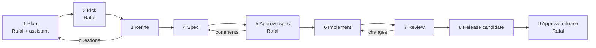

# ADR-011: Agent orchestration

- **Status:** Accepted
- **Date:** 2026-10-27

## Context

Agents must deliver stories inside the gates of [ADR-008](0008-ci-cd-and-release.md) and the Jira flow of [ADR-010](0010-tracker-and-story-workflow.md), on Rafal's Claude subscription, with every step visible.

## Decision

- **Agents run in GitHub Actions** (the Claude Code GitHub Action), started by Rafal with one click at first and by events later. They never use Rafal's credentials; every run is logged in one place.
- **Agents reach Jira through a small script** in the repository offering only what they need: read a story, comment, set the verdict, move to the states their role allows.
- **Agents never talk to each other.** Each is a fresh run with one role skill; it reads what the previous step left (story, spec, pull request, review) and writes what the next step needs.

| Agent | Started when | Hands over |
| --- | --- | --- |
| Refinement | Rafal moves a story to Refinement | Verdict in Jira; story to Ready or Needs input |
| Spec | Story reaches Ready | Pull request adding `docs/specs/<key>.md`; story to Spec review |
| Implementation | The spec merges | Change pull request citing the spec; CI moves the story to In review |
| Review | The change pull request opens or updates | GitHub review: approve, or changes requested |
| Fix | Changes are requested | New commits on the same pull request |

**When something goes wrong**

| Situation | What happens |
| --- | --- |
| Story unclear | Questions posted; story to Needs input; Rafal answers; refinement runs again |
| Spec not right | Rafal comments; the spec agent revises the same pull request |
| CI fails | The implementation agent fixes it |
| Review rejects three times | Story to Needs input with a summary; Rafal clarifies, splits or drops it |
| Change touches an ADR, standard or register | Code owners require Rafal's approval |
| Agent run fails or hits its limit | Run marked failed; story stays; Rafal restarts it |
| Pre-release check fails | No candidate; a Bug goes through the same flow |

**Planning assistant.** Claude Code in VS Code or the Claude app, working for Rafal: brainstorms, proposes stories in the story template, and on "push" creates or updates the batch in Jira Backlog through the same script. It approves nothing; the refinement agent checks every story independently.

**Rules**

- **Two GitHub identities:** builder agents act as the Claude GitHub App; the review agent acts as the machine account `rrogoz-sw-review`, whose approval counts for branch protection. Neither is an admin. Jira: one agent account, each comment tagged with the role.
- **Gates as GitHub approvals:** spec approval is Rafal's code-owner approval of the spec pull request; ADRs, standards, identity and source switches go through code owners; PROD is his approval on `prod-release`. CI refuses an implementation pull request whose spec is not on main.
- **The review cannot be tampered with:** the review workflow runs from main and reads CI results instead of running the change's code with its token. It never edits code.
- **Least privilege per role:** each workflow grants only the tools and permissions its role needs.
- **Instructions and skills:** one short `AGENTS.md` that links to the docs, and a `CLAUDE.md` that imports it. Skills in `.claude/skills/`: one per standard, one per role (plan, refine, spec, implement, review), and task skills that follow the runbooks. This replaces the `agent/` folder in ADR-009.
- **One story at a time through M1,** then up to three in parallel; stories touching the same entity or source wait. Branches must be up to date before merge.
- **Limits:** agents start only on an event, never in a loop; each run has a turn and time limit; at most three review rounds; one run per story; a pause switch (one repository variable) stops every agent.
- **Rollout:** end of M0, every agent starts with one click. In M1, review, fix and implementation start on GitHub events; late in M1, refinement and spec start from Jira status, polled every 30 minutes.
- **Supervised mode in M1:** Rafal is the required approver on every pull request. From M2, once metrics justify it, back to his four gates and automatic merge. Supervised approvals count as gates, not interventions.
- **Models per role:** strongest for planning, spec and review; middle for refinement, because verdict accuracy is a demo goal (Rafal, 2026-11-10), and for implementation, moving up when a story fails twice; lighter for small fixes. Tuned from the metrics.
- **Usage limits:** agents and Rafal's own chats share one subscription allowance. When the limit is reached, **we wait:** the run stops cleanly, nothing half-done can merge, and the agent resumes after the reset. No paid extras.

## Consequences

- Every agent run is logged in GitHub Actions, and no agent holds Rafal's credentials.
- Throughput is bounded by one subscription allowance; when it runs out, work waits.

## Options considered

- Agents on Rafal's laptop first: they would act with his credentials, and runs would not be logged in one place.
- Atlassian's MCP server for Jira: full access, on AI credits with an unclear free allowance.
