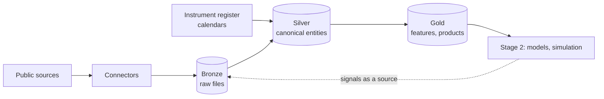

# Overview

What the project is for, what Stage 1 delivers, and how we know it worked. Principles are in [principles.md](principles.md), decisions in [adr/](adr/README.md), terms in [glossary.md](glossary.md).

## Goal

**North star:** build, with AI agents doing the delivery, a source-independent market data platform on which Rafal researches trading models and runs the best one with small real capital, with results that are measured and reproducible.

Two outcomes, both required:

1. **A working investment research platform.** Market data, then features and labels, then model signals, then simulated and finally small-capital trading. Stage 1 builds the platform; Stage 2 uses it.
2. **Proof that agentic delivery works.** Agents build the platform story by story, Rafal only directs, and the process is measured.

It also solves a problem known from work: a change of data source must not force a change of the data model.

**Test for every decision:** does it bring us closer to trading decisions backed by reproducible data, delivered by agents? If it does neither, it is out of scope.

**Not the goal:** a product for other users, a showcase of tools for their own sake, or live broker integration before Stage 2 has proven results.

## Stage 1: agentic delivery

AI agents take a story from ticket to PROD while Rafal acts only as supervisor and director. The domain is a medallion data platform for financial market data ([ADR-001](adr/0001-medallion-with-canonical-model.md)). The value is in the skills and specs, not the pipeline itself: the demo must show that agents stay within the architecture and that their readiness verdicts are accurate.

### Goals

1. Show a ticket-to-PROD flow where agents do the work and Rafal only directs and approves at gates.
2. Show that agents follow the agreed architecture and standards without being reminded.
3. Show that the readiness verdict (doable or not) is accurate.
4. Deliver a working, source-independent data platform that Stage 2 can build on.

### Metrics

Targets are set once the first stories give a baseline. How they are collected: [ADR-010](adr/0010-tracker-and-story-workflow.md).

| Metric | Target |
| --- | --- |
| Share of stories that pass review without fixes | Open |
| Time from ticket to DEV | Open |
| Human interventions per story, and at which step | Open |
| Accuracy of the "doable" verdict | Open, needs a scoring rule (set at M1) |

### Deliverables

| # | Deliverable | Accepted when |
| --- | --- | --- |
| 1 | Architecture decisions ([adr/](adr/README.md)) | Every principle is recorded with its reason and status |
| 2 | Standards (`standards/`) | Each standard area has written rules an agent can check |
| 3 | Skills catalogue | Each standard is enforced by at least one skill |
| 4 | Delivery workflow: roles, gates, Definition of Ready and Done | One story runs end to end following it |
| 5 | Documentation structure | Every layer and entity has a documented place, updated in the same change |
| 6 | Repository skeleton with agent instructions | A fresh agent session can pick up a ticket using only the repository |
| 7 | Working platform for the first asset class: history plus daily load through all three layers | Daily load runs in PROD with tests green |
| 8 | Graded demo story backlog ([ladder](#demo-story-ladder)) | Each rung has at least one ready story |
| 9 | Demo evidence: the metrics per story | Metrics are reported for every delivered story |

Agents draft each deliverable; Rafal approves it.

### Requirements

1. **Asset-class scalability.** Currencies first, then commodities, equities and derived data. A new ticker or asset class never needs a model rebuild.
2. **Source independence.** Changing the data provider does not change silver or gold.
3. **History, then daily.** One initial history load, then daily increments.
4. **The agentic process is the subject of the demo.** Ticket to PROD with human gates and measurable results.
5. **Zero cost to start.** Free public data sources and free tooling only.
6. **Data handling.** The repository is public and holds only code, configuration, schemas, docs and synthetic test fixtures. No third-party market data and no secrets. Data lives outside and can be rebuilt by running ingestion.
7. **Portability.** Runs on any host without code changes. Everything that differs per host (data location, credentials, schedule) is configuration.

### Delivery workflow

1. **Refinement.** An agent checks the story against the docs and returns a verdict: ready, questions, or a proposed split.
2. **Spec** as a file in `specs/`. Gate: Rafal approves it.
3. **Implementation** on a branch, following the agent instructions and skills.
4. **Review** by a separate agent session. The author never reviews its own work.
5. **Deploy:** DEV, then the pre-release check on recent real data, then PROD only with Rafal's approval. Agents never have PROD access.
6. **Documentation** is updated in the same change.

**Definition of Ready.** A story goes to spec only when:

- it is linked to a Stage 1 goal or deliverable and names the layer and entity it touches;
- its acceptance criteria are testable;
- its data contract is known (source, entity, fields), or defining it is the story;
- no open decision blocks it (otherwise an ADR comes first);
- it fits in one change, and its dependencies are done.

**Definition of Done.** A story is done only when:

- acceptance criteria are met; tests are written and green (unit and data quality per layer touched);
- a separate review session approved it;
- docs, and an ADR if a decision was made, are updated in the same change;
- it passed the pre-release check and reached PROD after Rafal's approval;
- its metrics are recorded.

**Agent roles.** Documentation is not a separate role: implementation writes it, review checks it.

| Role | Input | Output | May not |
| --- | --- | --- | --- |
| Refinement | Story, docs, standards | Verdict with reasons | Write code or change the story's scope |
| Specification | Ready story | Spec in the repository | Start implementation before the spec is approved |
| Implementation | Approved spec | Change with tests and docs | Change architecture or standards, approve or merge its own change, touch PROD |
| Review | Change, spec, standards | Approve, or changes requested with findings | Fix the code it reviews |

**Rafal's gates.**

1. Spec approval.
2. Any change to architecture or standards (a new or changed ADR).
3. Instrument identity changes (D6) and switching a primary source (D9).
4. Release to PROD.

**Escalation.** A "not ready" verdict comes to Rafal with its questions; he answers, splits or drops the story. A change that fails review three times also comes to him ([ADR-011](adr/0011-agent-orchestration.md)).

### Demo story ladder

Stories get harder in four rungs:

1. **New instrument:** configuration only.
2. **New asset class:** a new connector.
3. **New data type:** a new silver entity, its contract and an ADR.
4. **New source:** a new connector plus reconciliation (D9).

### Milestones

No dates; each milestone ends with an exit check Rafal approves.

| # | Milestone | Content | Exit check |
| --- | --- | --- | --- |
| M0 | Foundations | Deliverables 1 to 6 | A fresh agent session can pick up a ticket using only the repository |
| M1 | Walking skeleton | EUR/PLN, USD/PLN, CHF/PLN from NBP, full history from 2002, through bronze, silver and gold, with calendar and quote status (D14) | Daily load runs in PROD with tests green; metrics recorded for every story |
| M2 | Rungs 1 and 2 | New pairs by configuration; a second asset class through a new connector | A rung 1 story needs no code change |
| M3 | Rung 3 | A new data type, for example corporate events (D7) or macro series | New entity with contract and ADR, no change to existing entities |
| M4 | Rung 4 | A new source, reconciled and switched (D9) | Switch approved by Rafal; silver and gold unchanged |
| M5 | Stage 1 close | Demo evidence report (deliverable 9); check against [Stage 2 requirements](#stage-2-requirements) | Every requirement is supported or has a ready story |

**M0** is built by a lighter flow: Rafal with Claude Code, one pull request per story, reviewed and merged by Rafal. M0 stories are labelled `bootstrap` and left out of the metrics. Branch protection, code owners and agent identities switch on at M0 story 8; from then on the full flow applies, in supervised mode ([ADR-011](adr/0011-agent-orchestration.md)).

**M1 seed list,** turned into Jira stories at the start of M1:

1. Engine skeleton: pipeline command, run id, run log, publish last, DEV storage; runs on fixtures.
2. Instrument register and its schema check (`FX.EURPLN`, `FX.USDPLN`, `FX.CHFPLN`).
3. Calendar reference files for `XWAR` and `NBP`, with their generator.
4. NBP connector, source config and contract tests on synthetic samples.
5. Bronze writing with metadata files, and quarantine.
6. dbt macros that generate staging and silver from config: `dim_instrument`, `map_instrument_source`, `fact_price_daily`, `ref_trading_calendar`.
7. Quote status and the completeness gate (D14).
8. Full-equals-incremental and replay tests.
9. First gold product and its tests.
10. History load from 2002 in DEV, then the pre-release check.
11. PROD: release pipeline, daily schedule, missed-run check, rollback runbook.
12. Spike: Stooq check (D7, access, terms of use).
13. Metrics report for every M1 story.

**Backlog seeds per rung:** further currency pairs, and an instrument whose symbol changes (rung 1); GPW equities such as WIG20 constituents, and commodities (rung 2); corporate events, and macro series with vintages (rung 3); a second price source with raw prices and events, reconciled against Stooq (rung 4).

## Stage 2 requirements

Stage 2 is data experimentation: features, labels, models, signals and a trading simulation. It starts after Stage 1 delivers, and nothing in Stage 1 depends on it. Models live in a separate private repository. Stage 2 also ingests its own outputs (signals, decisions, positions) as new sources and entities, without changing the existing model.

The Stage 1 architecture must support:

1. **Point-in-time data (D11, on D13).** Features and labels never use information from after their as-of date; a label records when it became known; macro data keeps its vintage.
2. **A generic external-producer contract.** Any producer outside the platform writes back through the same path as any source: bronze, contract, silver. Nothing specific to signals.
3. **Append-only, versioned records (D13).** Reruns never overwrite history; each record traces to its run and data version.
4. **Valuation across currencies.** Exchange rates are available to value positions in PLN.
5. **Deterministic replay (D13).** Any day can be recomputed with the same result, also after late data.
6. **Gold features never depend on signals or portfolios,** so the gold, model, bronze loop is never circular.

Trading calendar, quote status and the completeness gate are Stage 1 principles (D14).
